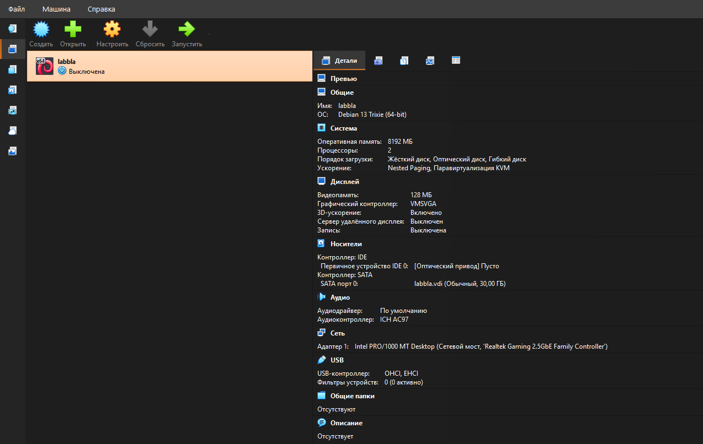
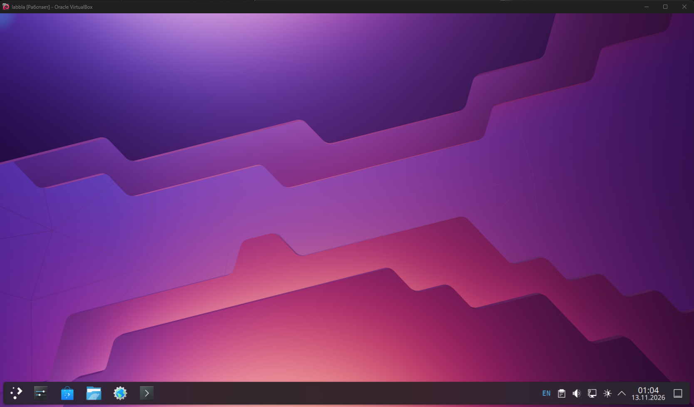
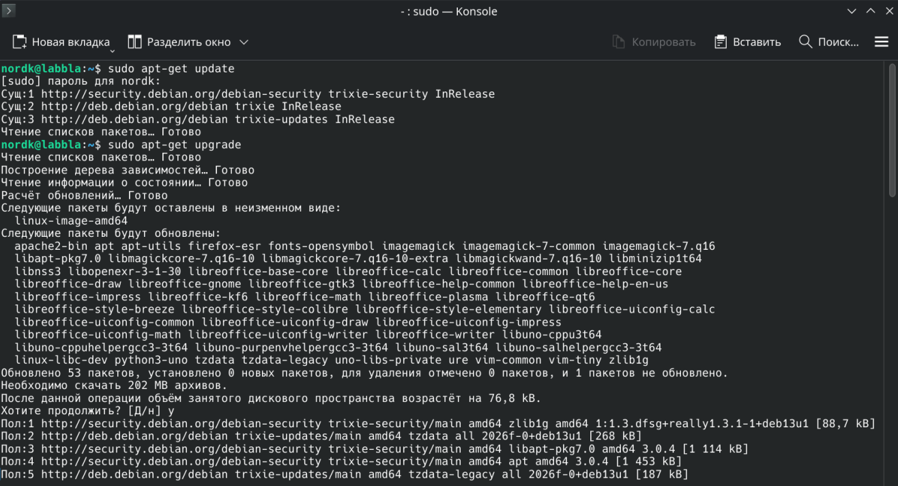
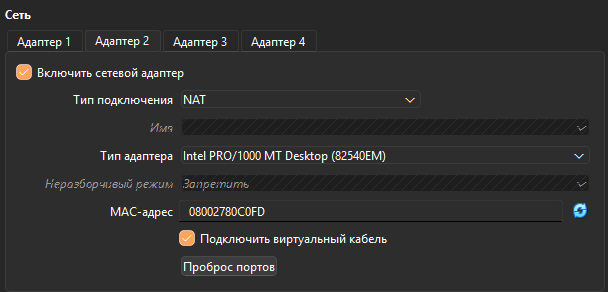
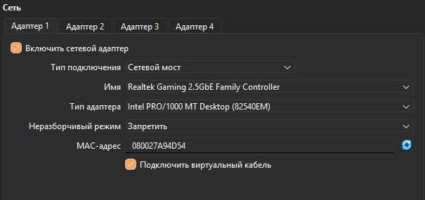
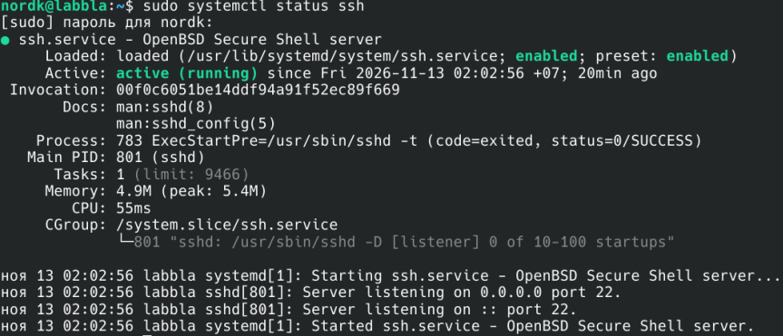
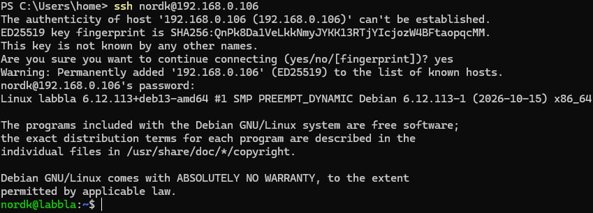
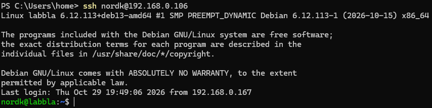

# debian-virtualbox-lab

# Лабораторная работа: Введение в виртуальные машины и установка Debian

## Цель работы

Создать виртуальную машину в Oracle VirtualBox, установить операционную систему Debian, выполнить обновление системы, настроить SSH-сервер и проверить удалённое подключение с использованием пароля и SSH-ключа.

## Используемые инструменты

- Oracle VirtualBox
- Debian Linux
- Windows PowerShell
- OpenSSH
- SSH-ключ

### 1. Установка и создание виртуальной машины

1. Установлен и настроен гипервизор Oracle VM VirtualBox.
2. Создана новая виртуальная машина, тип ОС — Linux, версия — Debian (64-bit). Подключён ISO-образ Debian 13 Trixie, скачанный с официального сайта [debian.org](https://www.debian.org/distrib/).
3. Для виртуальной машины выделено **8 ГБ** оперативной памяти, **2** вычислительных ядра ЦПУ и создан виртуальный жёсткий диск объёмом **30 ГБ**.

**Скриншот 1. Параметры виртуальной машины**



## 2. Установка Debian

Debian был установлен из ISO-образа. Во время установки были настроены параметры системы, создан пользователь и задан пароль. После завершения установки виртуальная машина успешно загрузилась.

**Скриншот 2. Запущенная система Debian**



## 3. Обновление системы

Для обновления списка пакетов и установки доступных обновлений были выполнены команды:

```bash
sudo apt-get update
sudo apt-get upgrade
```

Команда `apt-get update` обновляет список доступных пакетов, а `apt-get upgrade` устанавливает доступные обновления

**Скриншот 3. Обновление пакетов**



## 4. Настройка сети (NAT и Bridged)

Для одновременной работы виртуальной машины с интернетом и локальной сетью хост-компьютера в настройках ВМ (**Настройки → Сеть**) задействованы два сетевых адаптера:

- **Адаптер 1 — NAT** (Intel PRO/1000 MT Desktop): используется для выхода виртуальной машины в интернет через хост.
- **Адаптер 2 — Сетевой мост / Bridged** (Intel PRO/1000 MT Desktop, физический интерфейс хоста — Realtek Gaming 2.5GbE Family Controller): ВМ получает адрес в локальной сети хоста (`192.168.0.106`) и становится доступна для подключения с основного компьютера, в том числе по SSH.

**Скриншот 4. Настройки адаптера 2 (NAT)**



**Скриншот 5. Настройки адаптера 1 (сетевой мост / Bridged)**



## 5. Настройка SSH-сервера

Для организации удалённого доступа был установлен OpenSSH Server:

```bash
sudo apt-get install openssh-server
```

Затем SSH-сервер был включён и запущен:

```bash
sudo systemctl enable --now ssh
sudo systemctl status ssh
```

**Скриншот 6. Статус SSH-сервера**



## 6. Подключение по ssh по паролю

С хост-машины под управлением ОС Windows (через **Windows PowerShell**) выполнено подключение к виртуальной машине по IP-адресу сетевого моста (`192.168.0.106`) под пользователем `nordk`:

```powershell
ssh nordk@192.168.0.106
```

При первом подключении подтвержден криптографический отпечаток сервера (`ED25519 key fingerprint`) и введен пароль пользователя `nordk`.

**Скриншот 7. Первое подключение по SSH по паролю**



## 7. Доступ по SSH по криптографическому ключу

На основном компьютере (Windows PowerShell) сгенерирована пара RSA-ключей:

```powershell
ssh-keygen -t ed25519
```

Ключи сохранены в каталоге `C:\Users\<пользователь>\.ssh\` (`id_rsa` — закрытый, `id_rsa.pub` — открытый).

Открытый ключ `id_rsa.pub` необходимо поместить в файл `~/.ssh/authorized_keys` пользователя `nordk` на виртуальной машине.

C основного компьютера выполнена передача публичного ключа в файл `~/.ssh/authorized_keys` на виртуальную машину через PowerShell:

```powershell
Get-Content "$env:USERPROFILE\.ssh\id_rsa.pub" | ssh nordk@192.168.0.106 "mkdir -p ~/.ssh && cat >> ~/.ssh/authorized_keys"
```

После добавления ключа выполнено повторное подключение к серверу:

```powershell
ssh nordk@192.168.0.106
```

**Скриншот 8. вход без пароля**



## 8. Результаты работы

В ходе лабораторной работы была создана виртуальная машина в Oracle VirtualBox и установлена операционная система Debian. Система была обновлена, установлен и запущен SSH-сервер. Удалённое подключение через NAT было успешно проверено с использованием пароля и SSH-ключа Ed25519.